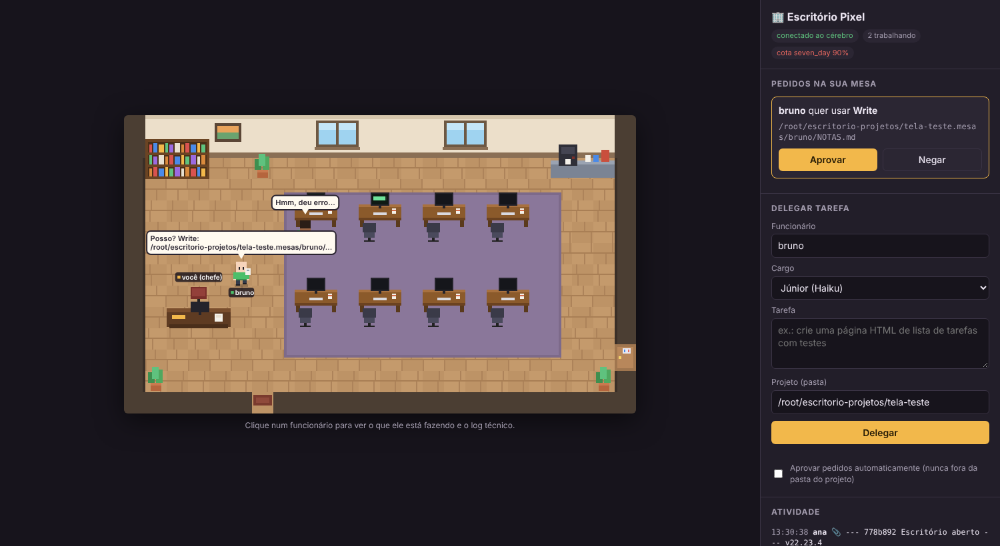

# Escritório Pixel de IA

Um escritório em pixel art onde funcionários de IA trabalham de verdade: por trás, sessões do Claude Code; na frente, personagens que andam, digitam, vão à estante, tomam café enquanto o teste roda e vão até a sua mesa pedir permissão.



## Instalar no Fedora

1. Baixe o `.rpm` da [última versão](https://github.com/cronistc/murphy/releases/latest).
2. Instale (ou dê dois cliques no arquivo):
   ```bash
   sudo dnf install ./escritorio-pixel-*.x86_64.rpm
   ```
3. Abra **Escritório Pixel** no menu de aplicativos. Na primeira vez: apresentação → conta Claude (assinatura Pro ou Max) → crie o seu escritório escolhendo a área (programação, design, escrita, direito, marketing, pesquisa) → o seu parceiro (o chefe) chega e te entrevista sobre o escritório e o projeto, anota tudo num relatório e recomenda uma equipe → você contrata.

## Como jogar

Você é o **gestor**. Ande pelo escritório com **WASD** ou as setas (ou clique onde quer ir). Chegue perto de algo e aperte **E**. A tela é só o escritório, com um HUD em pixel art: **F11** tela cheia, **T** equipe, **R** relatório do chefe, **M** menu, **Esc** fecha.

- **Diálogo:** falar com alguém abre uma caixa de diálogo com o retrato da pessoa em pixel art; a resposta aparece enquanto ela fala. Cada um tem uma parte rápida (Haiku, a personalidade, sempre ligada) e, quando a pergunta pede, para e "pensa melhor" com um modelo mais forte. O chefe organiza o escritório; você fala com qualquer um, mas a equipe fala com o chefe.
- **Vida própria:** cada pessoa tem idade, cidade, família, hobbies, pet, time, música; conversa sobre isso, e ideias de trabalho só aparecem a partir do que o projeto realmente já tem.
- **Vozes (opcional):** Menu → Configurar vozes, com uma chave gratuita do Azure Speech (vozes neurais da Microsoft em português). Sem chave, só balões.

- **Converse** com o **chefe ★** (Opus): diga o que quer construir. Ele planeja, distribui e, se faltar gente, **pede para contratar**. Fale com qualquer um de perto (E) ou pelo ramal (painel).
- **Contrate** em "+ Contratar alguém": júnior, pleno, sênior e especialistas (designer, redator, pesquisador, QA, arquiteto, T.I.), cada um com o guia do seu ofício.
- **Computadores:** sente numa mesa vaga ou na sua para abrir uma **área de trabalho**: navegador (prévia do projeto e internet), arquivos, editor de texto, terminal de verdade, histórico e "entregar meu trabalho"; na mesa de quem está trabalhando, você **vê a tela** da pessoa ao vivo e pode sentar junto.
- **Cofre:** histórico e **desfazer** entregas. **Roteador:** liga/desliga a internet da equipe. **Ar:** a temperatura é a carga real do PC. **TV:** jornal do dia com notícias reais. **Estante:** diário do escritório.
- **Ficha** (clique em alguém): humor, elogiar, bronca, férias, desligar, tarefa direta, log técnico.
- **Expediente:** o escritório abre quando você abre o app (luzes, chegada, daily) e fecha quando você fecha: cada um salva o trabalho, anota onde parou e vai embora. No dia seguinte, continuam de onde pararam.

| No escritório | O que está acontecendo de verdade |
| --- | --- |
| Digitando na mesa | Escrevendo ou editando arquivos |
| Na estante com um livro | Lendo arquivos, buscando, pesquisando |
| Cafezinho | Esperando um comando rodar (teste, build, instalação) |
| Indo até a sua mesa | Pedindo permissão, pedindo contratação ou entregando com evidência |
| Banheiro ("já volto") | Compactando o contexto |
| Almoço | Cota da conta perto do limite; voltam quando renova |
| Tela azul / "meu PC travou" | Erro na sessão; o chefe pode chamar o T.I. |
| Calor | Carga real do computador |
| Bebedouro, sofá, janela, plantas | Vida: só quem não está trabalhando |

Cada funcionário trabalha numa cópia própria do projeto (git worktree, branch `mesa/<nome>`); ao terminar, o trabalho entra na versão principal. Os projetos ficam em `~/escritorio-projetos`; os dados do escritório em `~/.local/share/escritorio-pixel/`.

## Rodar pelo código-fonte

Precisa de: [Node.js](https://nodejs.org) 22.18 ou mais novo, git, e o [Claude Code](https://claude.com/claude-code) instalado e logado na sua conta (rode `claude` uma vez e faça login).

```bash
git clone https://github.com/cronistc/murphy.git
cd murphy
npm install
npm start
```

Abra **http://127.0.0.1:4317** no navegador. No painel da direita:

1. **Delegar tarefa:** escreva um nome (cada nome é um funcionário com mesa própria), escolha o cargo e descreva a tarefa. O projeto padrão é `~/escritorio-projetos/meu-escritorio`; pode ser qualquer pasta vazia ou um repositório git seu.
2. **Pedidos na sua mesa:** quando alguém quer criar arquivo ou rodar comando, ele anda até a sua mesa e o pedido aparece aqui. Ou marque "Aprovar pedidos automaticamente". Nada fora da pasta do projeto é permitido em nenhum caso.
3. **Clique num funcionário** para ver o que ele está fazendo e o log técnico completo (clique numa linha para ver o evento bruto).

O trabalho de cada funcionário fica na branch `mesa/<nome>` do projeto, com commits. Para levar para a `main`: `git merge mesa/<nome>` na pasta do projeto.

| No escritório | O que está acontecendo de verdade |
| --- | --- |
| Digitando na mesa | Escrevendo ou editando arquivos |
| Na estante com um livro | Lendo arquivos, buscando, pesquisando na web |
| Cafezinho | Esperando um comando rodar (teste, build, instalação) |
| Indo até a sua mesa com ✋ | Pedindo permissão |
| Indo até a sua mesa com um papel | Entregando a tarefa (fala a primeira frase do resultado real) |
| Banheiro ("já volto") | Compactando o contexto |
| Saindo pela porta | Cota no limite (almoço) |
| Tela azul + "meu PC travou" | Erro na sessão |

Cores da camisa: verde = Júnior (Haiku), azul = Pleno (Sonnet), roxo = Sênior (Opus).

## Para desenvolvedores

- Etapa 1: uma sessão, eventos e log.
- Etapa 2: vários funcionários ao mesmo tempo, cada um na sua mesa (git worktree e branch próprios).
- Etapa 3: a tela 2D (`web/`), servida pelo cérebro.

```bash
npm run checar                     # tsc --noEmit
npm run demo                       # tarefa de exemplo (Haiku), aprova permissões automaticamente
npm run demo -- --perguntar        # pergunta s/n a cada permissão
npm run demo -- --modelo sonnet --pasta ~/meu-projeto "sua tarefa"
npm run demo:equipe                # 3 funcionários em paralelo + verificação no git
```

## Mesas

```
~/escritorio-projetos/meu-app            ← repositório principal (main), ninguém trabalha aqui
~/escritorio-projetos/meu-app.mesas/ana  ← worktree da Ana, branch mesa/ana
~/escritorio-projetos/meu-app.mesas/beto ← worktree do Beto, branch mesa/beto
```

A mesa é criada na primeira tarefa do funcionário e reaproveitada depois. Um funcionário faz uma tarefa por vez. O projeto pode ser uma pasta nova (vira repositório) ou a raiz de um repositório existente; pasta com arquivos que não é repositório é recusada.

## Servidor (o cérebro)

```bash
npm start                          # http://127.0.0.1:4317 ; APROVAR_TUDO=1, PROJETO=..., PORTA=...
curl -N http://127.0.0.1:4317/eventos
curl -X POST http://127.0.0.1:4317/sessoes -d '{"projeto":"/caminho","funcionario":"ana","tarefa":"...","modelo":"haiku"}'
curl -X POST http://127.0.0.1:4317/sessoes -d '{"pasta":"/caminho","tarefa":"..."}'   # sem mesa
curl "http://127.0.0.1:4317/mesas?projeto=/caminho"
curl http://127.0.0.1:4317/sessoes                     # sessões e permissões pendentes
curl -X POST http://127.0.0.1:4317/permissoes/<id> -d '{"aprovar":true}'
```

## Eventos

| Evento | No jogo (futuro) |
| --- | --- |
| `sessao_iniciada`, `cli_pronta` | chega e liga o computador |
| `ferramenta_chamada` / `ferramenta_resultado` | digitando, lendo na estante, cafezinho (build/teste) |
| `permissao_pedida` / `permissao_respondida` | vai até a mesa do chefe |
| `cota` | almoço quando a janela de 5h estiver perto do limite |
| `compactacao` | banheiro ("já volto") |
| `tarefa_terminada` | entrega com evidência |
| `erro` | "meu PC travou" |

Logs: `logs/<sessao>.eventos.jsonl` (normalizados) e `logs/<sessao>.bruto.jsonl` (mensagens originais da CLI).
